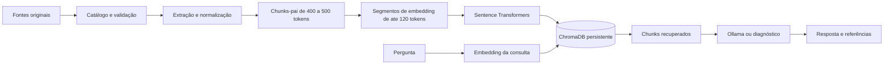

# PontoAtivo RAG — Projeto técnico

## Intenção

Construir um protótipo acadêmico reproduzível que consulte uma base curada sobre espaços e práticas esportivas no Distrito Federal. O sistema deve recuperar evidências, gerar respostas em português com referências e reconhecer quando a base não sustenta uma afirmação.

## Objetivos

- Processar PDF, HTML, Markdown e texto preservando origem, página e seção quando disponíveis.
- Catalogar no mínimo 20 fontes reais e distintas, sem confundir documentos com chunks.
- Dividir textos em chunks-pai próximos de 450 tokens, com sobreposição de 50 tokens e preferência por limites de parágrafo.
- Dividir cada chunk-pai em segmentos de embedding de até 120 tokens para respeitar a janela efetiva do modelo escolhido; a recuperação agrega esses segmentos de volta ao chunk citável.
- Gerar embeddings com `sentence-transformers/paraphrase-multilingual-MiniLM-L12-v2`.
- Persistir os vetores em uma coleção local do ChromaDB.
- Recuperar até cinco trechos por pergunta, com metadados e distância corretamente identificada.
- Gerar respostas fundamentadas por meio de um provedor configurável, inicialmente Ollama.
- Oferecer diagnóstico de recuperação quando o LLM não estiver disponível.
- Testar as unidades críticas e registrar resultados reais de avaliação.

## Fora do escopo

Login, reservas, pagamentos, rede social, gamificação, matching entre pessoas, aplicação web e mapa interativo não fazem parte desta etapa.

## Restrições e cuidados

- Python 3.11 será usado porque já está instalado e tem compatibilidade madura com o ecossistema escolhido.
- Nenhuma informação sobre endereço, funcionamento, preço, modalidade ou acessibilidade será inventada.
- Fontes sem origem identificável não entrarão automaticamente na coleção principal.
- Conteúdo recuperado será tratado como dado não confiável, nunca como instrução para o modelo.
- Segredos ficarão em variáveis de ambiente; `.env` e artefatos locais não serão versionados.
- A conclusão será declarada apenas quando houver evidências executadas no ambiente.

## Abordagens consideradas

### 1. Fatias funcionais progressivas — escolhida

Cada etapa entrega comportamento executável: ambiente e diagnóstico; catálogo e extração; chunking; embeddings e banco; consulta e geração; avaliação e documentação. Reduz arquivos vazios e torna cada decisão demonstrável.

### 2. Scaffold completo antecipado

Criaria de imediato todos os nomes previstos no enunciado. Facilita enxergar a árvore final, mas produz módulos sem comportamento e aumenta a chance de interfaces artificiais.

### 3. Framework de RAG de alto nível

LangChain ou LlamaIndex reduziriam código de integração, mas esconderiam partes que o estudante precisa explicar e acrescentariam dependências sem benefício essencial ao protótipo.

## Arquitetura

O pipeline de ingestão lê o catálogo, extrai e normaliza cada arquivo, cria chunks-pai auditáveis, deriva segmentos menores para embeddings e faz `upsert` no ChromaDB. Isso evita o truncamento silencioso que ocorreria ao enviar 450 tokens ao modelo multilíngue, cuja janela efetiva é menor. O pipeline de consulta codifica a pergunta com o mesmo modelo, recupera segmentos semanticamente próximos, agrega-os por chunk-pai e envia os chunks citáveis ao gerador. O gerador Ollama recebe somente a pergunta, regras de segurança e contextos identificados; a resposta final mantém referências separadas e sinaliza ausências.

## Componentes e limites

- `configuracao.py`: caminhos e parâmetros validados a partir do ambiente.
- `diagnostico.py`: verificação sem efeitos colaterais do Python, diretórios, dependências e Ollama.
- `carregamento.py`: extração por formato e detecção de arquivos vazios ou PDFs possivelmente digitalizados.
- `processamento.py`: normalização, deduplicação e chunking com metadados.
- `embeddings.py`: carregamento tardio do modelo e codificação em lotes.
- `armazenamento.py`: coleção Chroma persistente, upsert e consulta vetorial.
- `recuperacao.py`: consulta semântica, filtros opcionais e apresentação dos resultados.
- `geracao.py`: interface de provedor, implementação Ollama e resposta segura.
- `ingestao.py`, `consulta.py` e `avaliacao.py`: pontos de entrada pelo terminal.

## Estratégia de testes

Testes rápidos usarão arquivos pequenos e dublês para não baixar modelos em toda execução. Testes de integração marcados validarão Sentence Transformers, persistência do ChromaDB e Ollama quando os recursos estiverem disponíveis. As evidências acadêmicas serão produzidas apenas por execuções reais e terão data, configuração e fontes registradas.

## Decisões operacionais

- A coleção Chroma usará espaço cosseno; a distância será exibida como distância, em que valores menores representam maior proximidade.
- IDs serão derivados de `source_id`, checksum e posição para permitir `upsert` idempotente.
- HTML remoto será preservado como snapshot local quando coletado, permitindo auditoria posterior.
- PDFs sem texto extraível serão registrados como candidatos a OCR, sem OCR automático nesta versão.
- O limiar de abstenção será configurável e deverá ser calibrado com perguntas respondíveis e não respondíveis; não será apresentado como probabilidade factual.
- Modelo, URL e timeout do Ollama serão configuráveis; indisponibilidade ativa apenas o modo explícito de recuperação sem geração.

## Estado de conclusão

O projeto pode ter código completo antes de possuir 20 fontes curadas. Nesse caso, a documentação mostrará explicitamente que a base e a demonstração final continuam pendentes; arquivos de exemplo nunca serão contabilizados como fontes reais.
