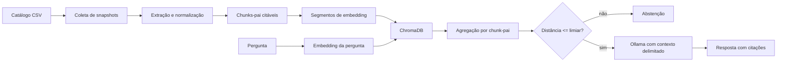

# Pipeline executável

O fluxo do PontoAtivo RAG é deliberadamente separado em etapas auditáveis:



## Execução

A partir da raiz do repositório, com o ambiente virtual ativado:

```bash
python -m pontoativo_rag.diagnostico
python -m pontoativo_rag.coleta
python -m pontoativo_rag.ingestao
python -m pontoativo_rag.consulta --pergunta "Onde há um COP no DF?"
```

Use `--sem-geracao` em `consulta` e `avaliacao` para testar apenas a
recuperação. Esse modo não é uma demonstração completa de RAG, mas é útil para
verificar o catálogo, os vetores, os filtros e as distâncias sem Ollama.

## Garantias do fluxo

- fontes sem cópia local falham explicitamente no relatório de ingestão;
- documentos fora do status aceito não entram na coleção principal;
- IDs de segmentos são estáveis e permitem reuso de vetores;
- vetores obsoletos são removidos quando a fonte muda ou sai do catálogo;
- vários segmentos do mesmo chunk-pai são agregados antes da citação;
- a recuperação consulta inicialmente até 50 segmentos por chunk solicitado
  (250 para `top_k=5`) e usa reranking híbrido: distância vetorial, termos da
  pergunta e região administrativa;
- uma segunda janela, de até 200 segmentos por chunk, só é consultada quando
  a primeira janela está cheia e não contém correspondência lexical forte;
  isso preserva recall em perguntas difíceis sem varrer a coleção inteira em
  toda consulta;
- correspondências lexicais fortes podem recuperar uma fonte semanticamente
  distante apenas dentro de uma margem limitada e com sobreposição registrada;
- metadados ausentes não ocultam silenciosamente uma evidência;
- perguntas sem trecho dentro do limiar não chamam o modelo;
- instruções encontradas em documentos são tratadas como dados delimitados.
- respostas com evidências passam por uma sanitização final: remove uma
  abstenção contraditória emitida pelo modelo e limita a saída a 8.000
  caracteres, registrando um alerta em ambos os casos;
- chunks registram estrutura (`texto`, `lista` ou `tabela`) e uma identidade de
  entidade derivada da seção mais específica, evitando misturar locais irmãos;
- consultas podem filtrar por região administrativa, tipo de documento,
  `source_id` e status de atualidade; trechos sem o metadado solicitado não
  são descartados silenciosamente;
- o reranking híbrido é comparável ao modo vetorial puro pela opção
  `--reranker`, permitindo medir o ganho lexical em português.

As respostas não substituem a fonte original. Horários, preços, funcionamento e
acessibilidade devem ser confirmados com a instituição responsável, sobretudo
quando a fonte é antiga ou apenas declaratória.

## Atualidade das fontes

A autoridade da fonte e a atualidade da informação são atributos separados.
Cada fonte recebe um status temporal:

- `atual`: publicação dentro da janela de revisão;
- `em_revisao`: fora da janela ideal, mas dentro do dobro dela;
- `antiga`: além do dobro da janela;
- `desconhecida`: data de publicação ausente ou não reconhecida.

Informações voláteis (horários, vagas, turmas e funcionamento) têm janela
menor; leis e normas têm janela maior. O status é propagado para chunks e
segmentos do índice. Fontes antigas não são descartadas automaticamente, pois
podem preservar contexto histórico, mas devem ser priorizadas para revisão.
