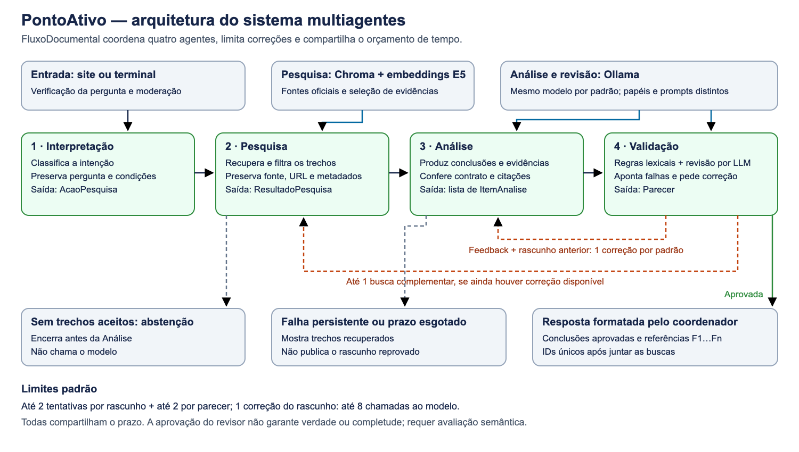
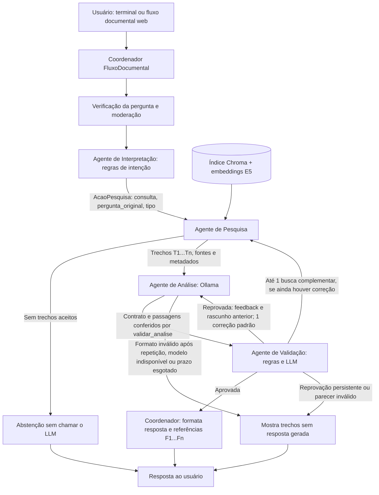

# PontoAtivo — primeiro sistema multiagentes

Entrega: 20/11/2026 · Verificação: 19/11/2026 · Canal: `4_Second Challenge`, pasta da equipe no Teams.

## Objetivo e atendimento ao enunciado

O PontoAtivo responde perguntas sobre espaços e práticas esportivas do Distrito Federal usando documentos da base curada. Seu fluxo documental implementa quatro papéis especializados em sequência, com coordenação central e contratos de dados explícitos.

| Requisito | Situação observada |
|---|---|
| Pelo menos dois agentes especializados | Implementado: Interpretação, Pesquisa, Análise e Validação |
| Responsabilidades claras | Separadas por módulos e descritas abaixo |
| Colaboração | Implementada: a saída da Interpretação alimenta a Pesquisa; as evidências da Pesquisa alimentam a Análise; a Validação revisa e pede correções ou uma busca complementar |
| Diagrama e fluxo | Documentados nesta entrega |
| Demonstração completa | Roteiro e script com registro das interações em `demonstracao.md` |
| Qualidade das interações | Há contratos, checagem de citações, uma repetição corretiva e tratamento de falhas; a qualidade semântica exige revisão humana |

São agentes em uma arquitetura de workflow: Interpretação usa regras, Pesquisa usa recuperação documental, Análise usa um LLM e Validação usa regras com revisão opcional por LLM. A fábrica do fluxo ativa o revisor com o mesmo modelo da Análise. A coordenação é central, com correções e uma busca complementar limitadas.

## Arquitetura

Versão editável: [arquitetura-agentes.svg](arquitetura-agentes.svg). O mesmo fluxo em texto (Mermaid):

A Análise tem até duas tentativas por rascunho para conferir formato e passagens. O agente de Validação tem até duas tentativas por parecer. Por padrão, o coordenador permite uma correção do rascunho (`max_correcoes=1`) e no máximo uma busca complementar. Assim, com revisão por modelo, são até oito chamadas ao LLM, todas sob o orçamento compartilhado. Cada chamada, inclusive a repetição do parecer, entra em `generation_attempts`. A formatação final pertence ao coordenador; não há um agente independente de Comunicação.

## Responsabilidades e contratos

| Componente | Entrada | Responsabilidade | Saída |
|---|---|---|---|
| Interpretação (`AgenteInterpretacao`) | Pergunta original | Normalizar caixa/acentos para classificar esportes, cadastro ou inclusão; preservar a pergunta e suas condições | `AcaoPesquisa` com `consulta`, `pergunta_original`, `tipo` |
| Pesquisa (`AgentePesquisa`) | Ação e filtros opcionais | Buscar no índice, selecionar evidências pela regra de relevância e manter a origem dos trechos | `ResultadoPesquisa`: status, trechos com IDs `Tn`, fontes, entidade, distância, descartes e tempo |
| Análise (`analisar_duvidas`) | Pergunta original e trechos aceitos | Produzir conclusões fundamentadas, distinguir lacuna, divergência e necessidade de esclarecimento | Lista de `ItemAnalise`: `duvida`, `estado`, `conclusao`, `trechos`, `evidencias` |
| Checagem da Análise (`validar_analise`) | JSON do LLM e trechos originais | Conferir campos, estados, IDs, fontes distintas em divergências e passagens literais | Itens válidos ou `AnaliseInvalida` |
| Validação (`AgenteValidacao`) | Pergunta, rascunho e trechos consolidados | Conferir apoio lexical e, com modelo, sentido, condições, completude, datas e lacunas | `Parecer` com aprovação, problemas e consulta complementar opcional |
| Coordenação (`FluxoDocumental`) | Pergunta e recursos | Encadear etapas, limitar tentativas, tratar indisponibilidade e mapear `Tn` para referências públicas `Fn` | `GroundedAnswer` e tempo de recuperação |

Arquivos de implementação: [interpretação](../../../src/pontoativo_rag/agentes/interpretacao.py), [pesquisa](../../../src/pontoativo_rag/agentes/pesquisa.py), [análise](../../../src/pontoativo_rag/agentes/analise.py), [validação](../../../src/pontoativo_rag/agentes/validacao.py), [coordenador](../../../src/pontoativo_rag/agentes/coordenador.py) e [contratos](../../../src/pontoativo_rag/agentes/contratos.py).

O campo `tipo` é repassado pela Pesquisa, mas não muda a estratégia de busca. A classificação é uma contribuição básica de interpretação; não existe planejamento dinâmico. O filtro de região é aplicado quando fornecido à Pesquisa, mas a Interpretação não extrai automaticamente uma região da pergunta.

## Fluxo de colaboração

1. O coordenador verifica a pergunta e chama a Interpretação.
2. A Interpretação entrega uma ação preservando o texto original.
3. A Pesquisa consulta a base e entrega evidências com origem, IDs e metadados. Ela não redige a resposta.
4. Sem evidência aceita, o coordenador encerra com abstenção. Com evidência, envia a pergunta e os documentos à Análise.
5. A Análise recebe instruções para preservar condições e datas, não transferir atributos entre locais e declarar lacunas. Produz JSON com passagens que sustentam suas conclusões.
6. A Análise confere formato e passagens. O agente de Validação revisa o rascunho e devolve problemas com trechos literais a corrigir. Havendo orçamento de correção, pode pedir uma busca complementar; o coordenador deduplica os chunks e mantém IDs únicos.
7. A Análise recebe o diagnóstico, o rascunho anterior e os trechos consolidados. A nova versão passa novamente pela Validação.
8. O coordenador apresenta as conclusões e referências ou, em caso de falha persistente, disponibiliza os trechos sem uma resposta redigida.

A colaboração ocorre por chamadas Python e estruturas compartilhadas em memória. A busca complementar é solicitada pela Validação e executada pelo coordenador. Não há fila de mensagens ou execução paralela. A interface web também possui um roteador para outras funções; o diagrama cobre especificamente o caminho documental.

## Avaliação da qualidade das interações

**Implementado:** preservação da pergunta, fontes rastreáveis, contratos, checagem de passagens literais, regras de apoio lexical, revisão por modelo, feedback específico com o rascunho anterior e busca complementar limitada. Só rascunhos aprovados são publicados quando a Validação está ativada.

**Limites:** a regra lexical pode rejeitar sinônimos corretos e aceitar frases falsas com as mesmas palavras da fonte. O revisor semântico também erra; aprovação não garante verdade nem completude. A [demonstração da Validação](../../agentes/validacao.md) injeta o primeiro rascunho e usa busca lexical no corpus do protótipo; a correção usa um modelo real. As rodadas com modelos de 8B tiveram reprovações indevidas de lacunas honestas. A revisão com `gemma4:12b` ainda precisa ser avaliada. As evidências desta pasta registram o fluxo anterior à integração do novo agente e não comprovam seu comportamento atual.

Os testes em `tests/pontoativo_rag/agentes/` verificam contratos, integração, rejeição de citações, abstenção, falhas do modelo, orçamento e preservação de fontes. Usam busca/LLM simulados: comprovam comportamento do código, não a qualidade geral do modelo real. Resultados históricos de avaliação do gerador anterior não devem ser apresentados como métricas deste coordenador.

**Conclusão:** os papéis e a colaboração sequencial estão implementados. A qualidade tem proteções concretas e cobertura automatizada, mas não está integralmente comprovada para perguntas arbitrárias. Uma demonstração real comprova o cenário executado; uma avaliação semântica mais ampla continua recomendada.

## Artefatos para a entrega

- Este documento: arquitetura, responsabilidades, fluxo e limites.
- [Diagrama da arquitetura](arquitetura-agentes.png) (PNG para slides; [SVG editável](arquitetura-agentes.svg)).
- [Roteiro de demonstração](demonstracao.md).
- Pasta `evidencias/`: execução real e resultados dos testes, quando presentes.
- [Script do fluxo documental](../../../scripts/demonstrar_multiagentes.py).
- [Demonstração da Validação](../../../scripts/demonstrar_validacao.py), [documentação e limites](../../agentes/validacao.md) e [registros](../../../experimentos/agentes/).

Enviar esta pasta e o script junto ao código do projeto para a pasta da equipe no Teams. O envio ao Teams não faz parte da verificação local realizada aqui.
