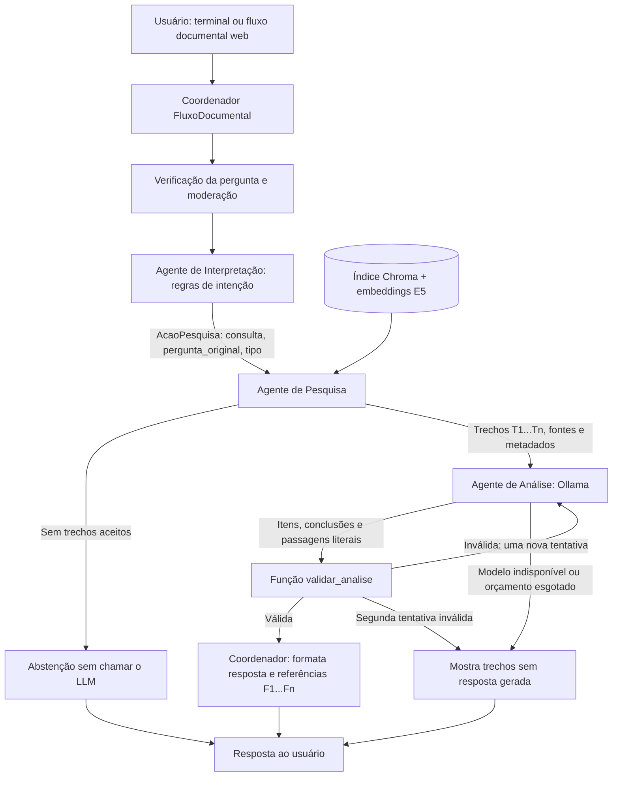

# PontoAtivo — primeiro sistema multiagentes

Entrega: 20/11/2026 · Verificação: 19/11/2026 · Canal: `4_Second Challenge`, pasta da equipe no Teams.

## Objetivo e atendimento ao enunciado

O PontoAtivo responde perguntas sobre espaços e práticas esportivas do Distrito Federal usando documentos da base curada. Seu fluxo documental implementa três papéis especializados em sequência, com coordenação central e contratos de dados explícitos.

| Requisito | Situação observada |
|---|---|
| Pelo menos dois agentes especializados | Implementado: Interpretação, Pesquisa e Análise |
| Responsabilidades claras | Separadas por módulos e descritas abaixo |
| Colaboração | Implementada: a saída da Interpretação alimenta a Pesquisa; as evidências da Pesquisa alimentam a Análise |
| Diagrama e fluxo | Documentados nesta entrega |
| Demonstração completa | Roteiro e script com registro das interações em `demonstracao.md` |
| Qualidade das interações | Há contratos, checagem de citações, uma repetição corretiva e tratamento de falhas; a qualidade semântica exige revisão humana |

São agentes em uma arquitetura de workflow: Interpretação usa regras, Pesquisa usa recuperação documental e Análise usa um LLM. Não são três LLMs independentes, nem uma equipe autônoma que negocia tarefas. O enunciado fornecido não exige essa autonomia; se essa for uma exigência adicional da disciplina, será necessário ampliar a implementação.

## Arquitetura

Versão editável: [arquitetura-agentes.svg](arquitetura-agentes.svg). O mesmo fluxo em texto (Mermaid):

O ciclo corretivo tem no máximo duas chamadas ao modelo, sujeito ao orçamento de execução. A validação é uma função dentro do módulo de Análise; a formatação final pertence ao coordenador. Não há agentes independentes de Validação ou Comunicação no fluxo auditado.

## Responsabilidades e contratos

| Componente | Entrada | Responsabilidade | Saída |
|---|---|---|---|
| Interpretação (`AgenteInterpretacao`) | Pergunta original | Normalizar caixa/acentos para classificar esportes, cadastro ou inclusão; preservar a pergunta e suas condições | `AcaoPesquisa` com `consulta`, `pergunta_original`, `tipo` |
| Pesquisa (`AgentePesquisa`) | Ação e filtros opcionais | Buscar no índice, selecionar evidências pela regra de relevância e manter a origem dos trechos | `ResultadoPesquisa`: status, trechos com IDs `Tn`, fontes, entidade, distância, descartes e tempo |
| Análise (`analisar_duvidas`) | Pergunta original e trechos aceitos | Produzir conclusões fundamentadas, distinguir lacuna, divergência e necessidade de esclarecimento | Lista de `ItemAnalise`: `duvida`, `estado`, `conclusao`, `trechos`, `evidencias` |
| Validação (`validar_analise`) | JSON do LLM e trechos originais | Conferir campos, estados, IDs, duplicatas e presença literal das passagens | Itens aprovados ou `AnaliseInvalida` |
| Coordenação (`FluxoDocumental`) | Pergunta e recursos | Encadear etapas, limitar tentativas, tratar indisponibilidade e mapear `Tn` para referências públicas `Fn` | `GroundedAnswer` e tempo de recuperação |

Arquivos de implementação: [interpretação](../../../src/pontoativo_rag/agentes/interpretacao.py), [pesquisa](../../../src/pontoativo_rag/agentes/pesquisa.py), [análise e validação](../../../src/pontoativo_rag/agentes/analise.py), [coordenador](../../../src/pontoativo_rag/agentes/coordenador.py) e [contratos](../../../src/pontoativo_rag/agentes/contratos.py).

O campo `tipo` é repassado pela Pesquisa, mas não muda a estratégia de busca. A classificação é uma contribuição básica de interpretação; não existe planejamento dinâmico. O filtro de região é aplicado quando fornecido à Pesquisa, mas a Interpretação não extrai automaticamente uma região da pergunta.

## Fluxo de colaboração

1. O coordenador verifica a pergunta e chama a Interpretação.
2. A Interpretação entrega uma ação preservando o texto original.
3. A Pesquisa consulta a base e entrega evidências com origem, IDs e metadados. Ela não redige a resposta.
4. Sem evidência aceita, o coordenador encerra com abstenção. Com evidência, envia a pergunta e os documentos à Análise.
5. A Análise recebe instruções para preservar condições e datas, não transferir atributos entre locais e declarar lacunas. Produz JSON com passagens que sustentam suas conclusões.
6. A validação confere o formato e as passagens. Em caso de falha, a Análise recebe uma instrução corretiva genérica e tenta novamente com os mesmos documentos.
7. O coordenador apresenta as conclusões e referências ou, em caso de falha persistente, disponibiliza os trechos sem uma resposta redigida.

A colaboração ocorre por chamadas Python e estruturas compartilhadas em memória. Não há fila de mensagens, execução paralela ou consulta adicional da Análise à Pesquisa. A interface web também possui um roteador para outras funções; o diagrama cobre especificamente o caminho documental.

## Avaliação da qualidade das interações

**Implementado:** preservação da pergunta, transferência de fontes e entidades, referências rastreáveis, saídas estruturadas, distinção entre ausência de evidência e conclusão sustentada, rejeição de passagens inventadas, correção limitada e fallback quando o modelo falha. O script de demonstração torna visíveis as entradas e saídas dessas etapas sem substituir o modelo ou a busca.

**Limites:** uma passagem literal pode ser verdadeira e ainda assim não sustentar a conclusão produzida. A validação atual não verifica implicação semântica, não garante que todas as condições da pergunta foram respondidas e não exige duas fontes diferentes para uma divergência. As instruções ao LLM cobrem parte desses riscos, mas não constituem garantia automática. A correção não recebe um diagnóstico detalhado de cada erro nem o rascunho anterior. Não existe replanejamento ou nova recuperação após uma lacuna.

Os testes em `tests/pontoativo_rag/agentes/` verificam contratos, integração, rejeição de citações, abstenção, falhas do modelo, orçamento e preservação de fontes. Usam busca/LLM simulados: comprovam comportamento do código, não a qualidade geral do modelo real. Resultados históricos de avaliação do gerador anterior não devem ser apresentados como métricas deste coordenador.

**Conclusão:** os papéis e a colaboração sequencial estão implementados. A qualidade tem proteções concretas e cobertura automatizada, mas não está integralmente comprovada para perguntas arbitrárias. Uma demonstração real comprova o cenário executado; uma avaliação semântica mais ampla continua recomendada.

## Artefatos para a entrega

- Este documento: arquitetura, responsabilidades, fluxo e limites.
- [Diagrama da arquitetura](arquitetura-agentes.png) (PNG para slides; [SVG editável](arquitetura-agentes.svg)).
- [Roteiro de demonstração](demonstracao.md).
- Pasta `evidencias/`: execução real e resultados dos testes, quando presentes.
- [Script reproduzível](../../../scripts/demonstrar_multiagentes.py).

Enviar esta pasta e o script junto ao código do projeto para a pasta da equipe no Teams. O envio ao Teams não faz parte da verificação local realizada aqui.
