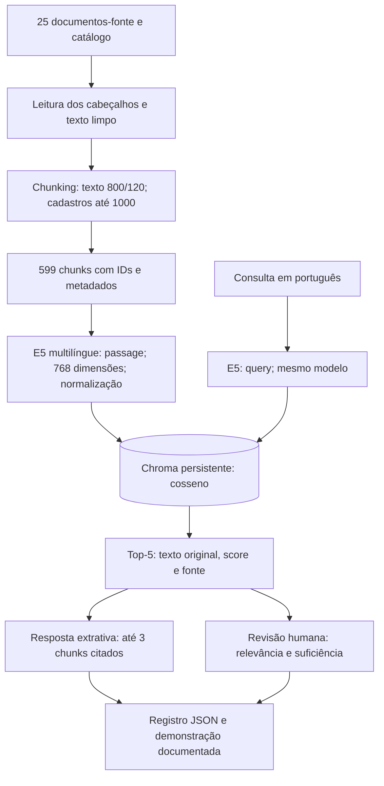

# Arquitetura do PontoAtivo

Protótipo local de recuperação semântica com resposta extrativa. O objetivo desta entrega é demonstrar a qualidade da recuperação, a fundamentação e a rastreabilidade; não há interface web nem LLM gerando respostas.

O diagrama está representado abaixo em Mermaid e incorporado ao documento único da entrega em Semana 2/DOCUMENTAÇÃO/Entrega_Semana_2.pdf.

| Componente | Implementação | Responsabilidade |
|---|---|---|
| Fontes e curadoria | dados/fontes/texto/; AUDITORIA.md | 25 documentos selecionados e limpos, origem, data e limitações |
| Catálogo | dados/catalogo.csv | Inventário derivado dos cabeçalhos dos arquivos efetivamente ingeridos |
| Chunking | src/ingestao/chunking.py | Preservar texto, atribuir ID global, enriquecer texto de indexação |
| Embeddings | src/ingestao/embeddings.py | E5 local, passage/query, vetores normalizados de 768 dimensões |
| Persistência | src/ingestao/banco.py | Coleção pontoativo_fontes, índice HNSW com distância de cosseno |
| Ingestão | src/ingestao/carga.py | Gerar vetores e gravar texto original e metadados em lotes de 256 |
| Recuperação | src/recuperacao/buscar.py | Consulta vetorial top-k; filtro de metadados opcional pela API Python |
| Resposta | src/geracao/responder.py | Reproduzir os 3 primeiros chunks sem acrescentar fatos |
| CLI | src/main.py | Receber pergunta, exibir recuperação, resposta e exportar JSON |
| Evidências da entrega | Semana 2/DEMONSTRAÇÃO DO RAG/executar.py | Executar código, fontes, banco e modelo locais e registrar consulta, resposta e fontes |

## Escolhas e limites

A resposta extrativa torna a fundamentação auditável: cada trecho conserva seu ID, título, URL, publicação, coleta e ressalvas. Não há paráfrase automática nem custo de API. O leitor precisa avaliar quais evidências respondem à pergunta; o sistema ainda não possui detecção automática de insuficiência. A demonstração inclui sínteses revisadas manualmente e um caso sem evidência suficiente.

Similaridade não é confiança nem probabilidade. Documentos próximos podem ser irrelevantes para parte da consulta. O top-k é configurável (padrão 5) e não há limiar fixo. A recuperação não confirma disponibilidade em tempo real, funcionamento atual ou acessibilidade em campo.

No Artefatos.zip enviado ao Teams, o código fica em implementacao/src/ e o banco em implementacao/dados/vetorial/. O modelo e o ambiente virtual não fazem parte do ZIP; a primeira execução em outra máquina requer instalação das dependências e download do modelo. O PDF da demonstração e demonstracao/resultado.json registram a execução sobre o conteúdo desse ZIP.
